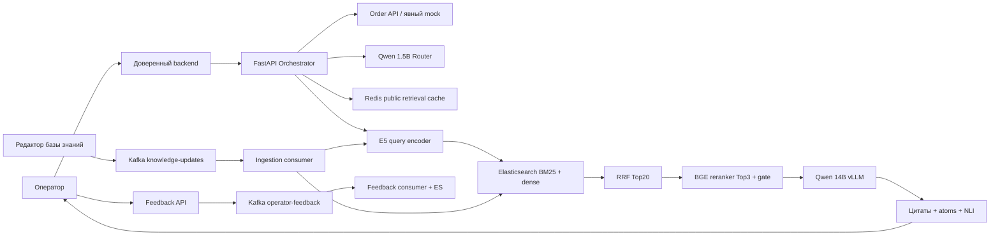

# Архитектура и границы доверия

Клиент не общается с LLM. Ни router, ни generator не имеют tools, credentials
Order API или прямого доступа к БД. `OrderPort` возвращает только разрешённый
контекст билетов. `MockOrderClient` принимает только demo-trip/demo-operator.
`OrderClient` — HTTP-адаптер к описанному контракту, не реальная интеграция.
OpenAPI ожидаемого Order API приведён в `contracts/order-api.yaml`.

`Settings` читает env; `api.lifespan` создаёт общий HTTPX pool, ES client и Redis.
`Orchestrator` принимает порты, поэтому unit tests подставляют независимые fakes.
`ModelServices` объединяет только транспорт к трём раздельным model endpoints.
Модели загружаются в lifespan model services, а не при импорте модуля.

Backend подтверждает личность оператора, разрешение на обращение и привязку trip_id.
В примере FastAPI проверяет shared service credential и доверяет X-Operator-ID
только от backend; это учебная граница, не полноценная OIDC/mTLS авторизация.
Order API повторно проверяет доступ оператора к поездке. Нельзя выставлять FastAPI
в открытый интернет с доверием к пользовательскому заголовку.

В LLM уходят минимальные route/date/status, без ФИО, телефона, паспортов и оплаты.
История всё ещё может содержать введённые вручную PII: production нужен отдельный
redaction этап до LLM. В логах нет запросов, ответов, токенов и payload exceptions.
Промпт не является полноценной защитой от prompt injection: проверка фактов и
источников, ACL документов, ограниченный retrieval и operator approval обязательны.

Границы сервисов: FastAPI масштабируется по HTTP нагрузке; vLLM — по GPU;
E5/BGE/NLI — по latency и памяти; Kafka workers — по partitions. Отдельные
Dockerfile и Deployment позволяют изменять эти компоненты независимо.
